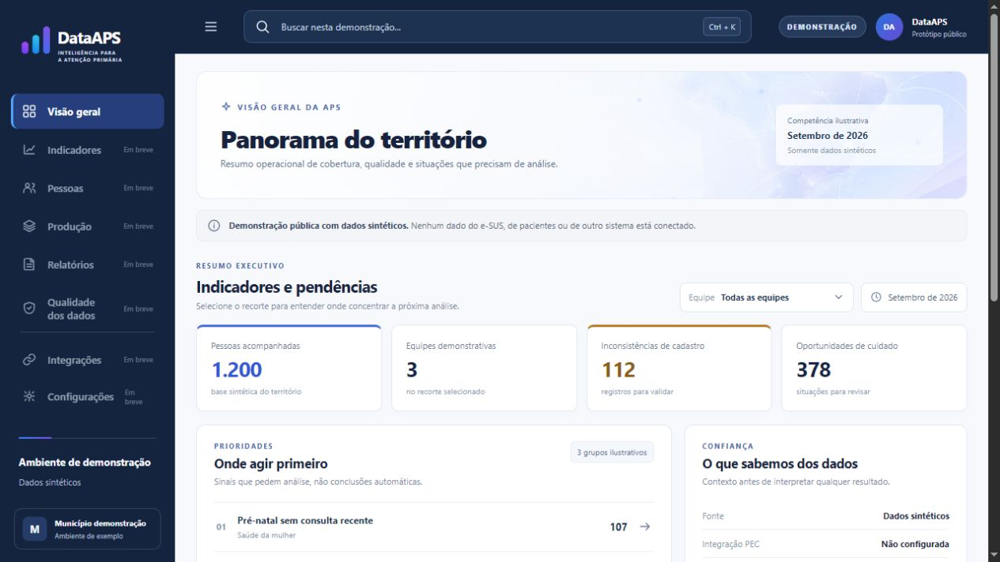
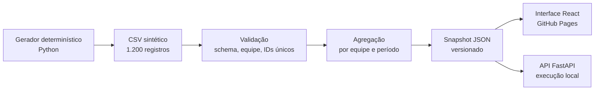

<div align="center">


# DataAPS Demo

**Painel para gestores e equipes da Atenção Primária acompanharem cobertura e qualidade dos registros e identificarem pontos que precisam de análise.**

[](https://github.com/LeandroAValle/dataaps-demo/actions/workflows/showcase.yml)


[**Abrir demonstração**](https://leandroavalle.github.io/dataaps-demo/) · [Arquitetura](docs/ARCHITECTURE.md) · [Decisões técnicas](docs/DECISIONS.md) · [Dicionário de dados](docs/DATA.md)

</div>

---

## O problema

Gestores e equipes de Atenção Primária precisam acompanhar cobertura, qualidade dos registros e situações que merecem investigação. O DataAPS reúne esses sinais em um panorama por equipe e período, com contexto sobre a fonte e a regra de cada indicador, para orientar a análise sem gerar conclusões automáticas.

**Este é um projeto de portfólio.** Todos os registros e indicadores são fictícios. Não há conexão com e-SUS APS, PEC, sistemas municipais ou dados de pacientes. As regras são ilustrativas e não representam critérios clínicos ou indicadores oficiais.

## O que é possível explorar

- Filtrar o panorama por três equipes fictícias.
- Ver indicadores de acompanhamento e qualidade, uma tendência de 12 períodos e sinais de revisão.
- Abrir cada prioridade para ler o motivo ilustrativo de sua presença.
- Consultar o mesmo snapshot pela API local, com documentação interativa em `/docs`.
- Regerar os dados e verificar a transformação de ponta a ponta.



## Fluxo de dados



O snapshot é produzido por `pipeline/build.py` a partir de `data/raw/people_synthetic.csv`. A interface pública carrega esse JSON estático; a API local lê o mesmo arquivo. Isso mantém os números coerentes entre as duas superfícies sem depender de servidor ou credenciais para a demonstração.

## Tecnologias e por que foram usadas

| Camada | Ferramentas | Papel no protótipo |
| --- | --- | --- |
| Geração e transformação | Python 3.11+, biblioteca padrão (`csv`, `json`, `random`) | Criar dados reproduzíveis, validar registros e calcular agregações. |
| API | FastAPI, Uvicorn | Expor contexto, resumo e oportunidades em endpoints de leitura. |
| Interface | React 19, TypeScript, Vite, CSS | Explorar os indicadores com filtro, busca e visualização responsiva. |
| Qualidade | Pytest, TypeScript, npm audit, GitHub Actions | Verificar consistência, build e dependências antes de publicar. |
| Publicação | GitHub Pages | Hospedar a interface estática sem infraestrutura de saúde. |

As escolhas e seus limites estão detalhados em [Decisões técnicas](docs/DECISIONS.md).

## Executar localmente

**Pré-requisitos:** Python 3.11+, Node.js compatível com o `package-lock.json` e npm.

```bash
python -m venv .venv
# Windows: .venv\Scripts\activate
# macOS/Linux: source .venv/bin/activate
python -m pip install -r requirements-dev.txt
python -m pipeline.generate
python -m pipeline.build
python -m pytest pipeline/test_build.py api/tests/test_api.py
```

Em outro terminal:

```bash
cd web
npm ci
npm run dev
```

A interface fica em `http://127.0.0.1:5173`. Para experimentar também a API, a partir da raiz do repositório:

```bash
cd api
python -m uvicorn app.main:app --reload --port 8000
```

Documentação da API: `http://127.0.0.1:8000/docs`. Para fazer a interface buscar a API em vez do snapshot estático, crie `web/.env.local` com `VITE_DATAAPS_API_URL=http://127.0.0.1:8000`.

## Regras dos indicadores

| Indicador | Cálculo nesta demonstração |
| --- | --- |
| Pessoas acompanhadas | Quantidade de IDs sintéticos únicos no recorte. |
| Acompanhamento em dia | Percentual de registros com valor `1` no último período do histórico fictício. |
| Qualidade dos dados | Percentual de registros com campos essenciais marcados como completos. |
| Inconsistências | Quantidade de registros com campos essenciais incompletos. |
| Oportunidades | Soma dos sinais ilustrativos de pré-natal, vacinação e cadastro incompleto. |

Veja os campos, as limitações e a proveniência em [Dicionário de dados](docs/DATA.md). A interface não faz recomendação clínica nem lista pessoas.

## Estrutura

```text
api/                  API de leitura e testes de contrato
data/raw/             CSV sintético gerado de forma determinística
docs/                 Arquitetura, decisões, dados e captura de tela
pipeline/             Geração, validação, agregação e testes
web/                  Interface e snapshot JSON publicado
.github/workflows/     Testes, build e publicação
```

## Limites e próximos passos

Esta versão demonstra o percurso de dados e a apresentação do resultado. Não implementa autenticação, ingestão de dados reais, integração com PEC, armazenamento operacional nem regras clínicas oficiais. Uma evolução real exigiria autorização, governança, validação dos indicadores com especialistas, controle de acesso, rastreabilidade de cargas e avaliação de segurança.

## Autor

**Leandro Valle** — desenvolvimento de sistemas, migração e integração de dados. [LinkedIn](https://www.linkedin.com/in/leandro-valle-68573a140/) · [Perfil GitHub](https://github.com/LeandroAValle)
