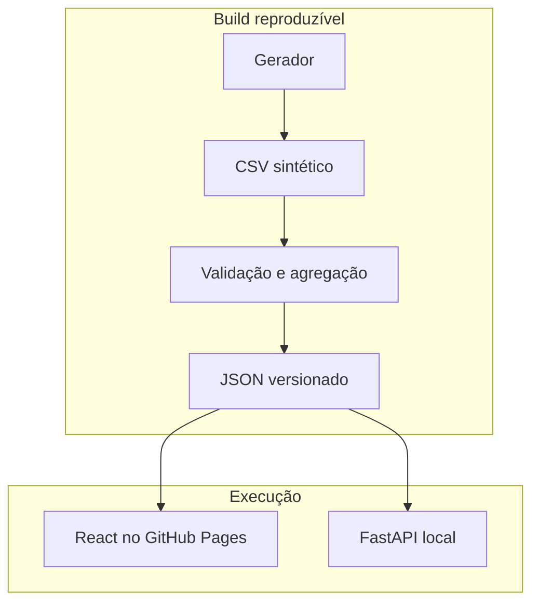

# Arquitetura

## Caminho de ponta a ponta

1. `pipeline/generate.py` cria 1.200 linhas sintéticas com semente fixa. Os identificadores `SYN-*` não representam pessoas reais.
2. `pipeline/build.py` valida unicidade, equipe, histórico mensal, completude e categoria dos sinais. Falha antes de publicar se uma linha violar o contrato.
3. A transformação agrega os registros para o território fictício completo e para cada equipe. Publica `web/public/dashboard.json` com versão de schema, fonte, período, status da regra, métricas e oportunidades.
4. A interface React carrega o snapshot no GitHub Pages. Se `VITE_DATAAPS_API_URL` estiver definido no desenvolvimento local, consulta os endpoints equivalentes da API FastAPI.
5. A API é somente leitura e usa o mesmo snapshot. Não contém cliente de banco de dados ou de plataforma de saúde.

## Fronteiras

O versionamento do snapshot permite revisar mudanças nos indicadores em pull requests. O gerador usa semente fixa para que diferenças no JSON reflitam alterações no código, não aleatoriedade a cada build.

## Contrato HTTP

| Rota | Resultado |
| --- | --- |
| `GET /health` | Estado da API e fonte sintética. |
| `GET /api/v1/context` | Equipes, período, fonte e versão do schema. |
| `GET /api/v1/dashboard/summary?team=...` | Indicadores e proveniência do recorte. |
| `GET /api/v1/opportunities?team=...` | Sinais ilustrativos e contagens agregadas. |

Uma equipe desconhecida recebe HTTP 400. As rotas não aceitam escrita. A interface pública não precisa de API em execução.
